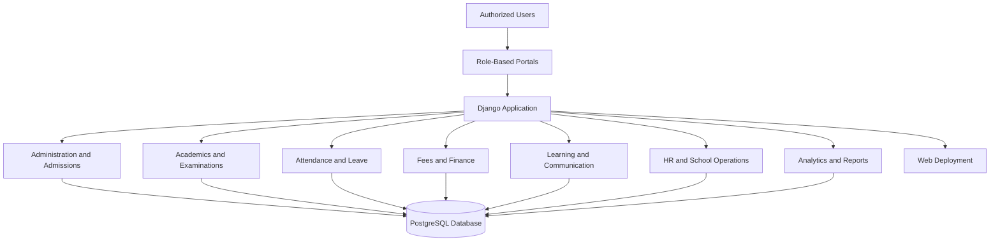

# 🏫 RumiWare SchoolOS

### A Modern, Full-Featured School Management System

  
  

  
  
  
  

---

## 📌 Project Overview

**RumiWare SchoolOS** is a comprehensive, web-based School Management System designed to bring essential academic, administrative, financial, and operational activities together in one centralized platform.

Built with **Python, Django, and PostgreSQL**, SchoolOS provides dedicated workflows for school administrators, teachers, students, guardians, and other authorized staff. It aims to reduce repetitive administrative work, organize school records, improve access to information, and simplify everyday school operations.

The platform combines traditional school administration with academic management, financial recordkeeping, communication tools, operational workflows, and reporting capabilities.

> 🎯 **Project goal:** Build a unified digital platform that helps schools manage their day-to-day operations more efficiently.

## 🔗 Explore the Project

| Resource | Link |
|---|---|
| 🌐 Live Website | [Open RumiWare SchoolOS](https://rumiware-schoolos.vercel.app) |
| 💻 Main Source Code | [School-Management-System on GitHub](https://github.com/HafizHassanAlee/School-Management-System) |
| 🏢 Organization | [RumiWare on GitHub](https://github.com/Rumi-Ware) |
| 🌍 Company Website | [rumiware.com](https://rumiware.com) |

## ✨ Key Features

SchoolOS brings together multiple school workflows in a single application.

### 👨‍💼 1. Administration and User Management

- Role-based access control and permission groups.
- Secure sign-in and sign-out workflows.
- Database-backed login throttling.
- Email-based password reset functionality.
- Administrator dashboard and school settings.
- School identity, contact information, principal details, and logo settings.
- Account information and authorized profile management.
- Read-only audit trail for supported activities.

### 🎓 2. Student Management and Admissions

- Student admission and profile management.
- Automatically generated admission numbers.
- Enrollment history and academic placement records.
- Class, section, and academic-year assignments.
- Student profile images and protected image access.
- Guardian profiles and explicit student–guardian relationships.
- Enrollment transitions and historical record preservation.
- CSV import preview and confirmation workflows.
- Printable student records.

### 👩‍🏫 3. Teacher, Staff, and Academic Management

- Teacher and staff profiles.
- Academic-year and term configuration.
- Class, section, and subject management.
- Teacher assignments by academic year, section, and subject.
- Academic structure and enrollment management.
- School-specific academic configuration.
- Staff records and employment history through the HR module.

### 📅 4. Attendance Management

- Student attendance registers.
- Teacher and staff attendance registers.
- Present, absent, late, and excused attendance statuses.
- Attendance policies and working-day calendars.
- Public holidays, school holidays, and unexpected closures.
- Arrival-time and late-status rules.
- Draft attendance registers and finalization workflows.
- Controlled corrections to finalized attendance.
- Leave management and attendance-related notifications.
- Attendance calendars, dashboards, and reports.
- Permission-scoped CSV and PDF exports.

### 📝 5. Examinations and Results

- Configurable examination and assessment types.
- Examination sessions and date sheets.
- Subject and assessment components.
- Configurable grading policies and grade bands.
- Weighted assessments and subject grading.
- Scoped marks-entry workflows.
- Independent result review and approval workflows.
- Result publication and immutable publication snapshots.
- Controlled corrections to published results.
- Student and guardian result access.
- Performance analytics and printable PDF report cards.

### 💰 6. Fees and Financial Management

- Fee categories and dated fee structures.
- Class- and section-based fee configuration.
- Billing cycles and invoice generation previews.
- Invoice approval and issuance workflows.
- Manual fee collection records.
- Payment allocation and advance-credit handling.
- Receipt generation and immutable financial records.
- Refunds and transaction reversals.
- Expense recording and reconciliation.
- Financial journals and balanced ledger entries.
- Finance reports and authorized family fee access.

**Important:** The finance module records internal financial transactions. The project documentation does not claim integration with real banking or online payment gateways.

### 👨‍👩‍👧 7. Student, Guardian, and Teacher Portals

- Dedicated student, guardian, and teacher workspaces.
- Personalized dashboards and relevant academic information.
- Guardian access to linked children.
- Student-specific academic and attendance information.
- Teacher workspaces scoped to assigned classes and subjects.
- Unified notifications and relevant school updates.
- Personal account settings and access controls.

### 🗓️ 8. Timetable and Scheduling

- Weekly timetable creation and management.
- Timetable drafts, publication, copying, and archiving.
- Classroom, laboratory, and room management.
- Teacher availability configuration.
- Scheduling conflict checks.
- Teacher workload limits and free-period reporting.
- Approved teacher substitutions.
- Timetable completeness checks and scheduling reports.

### 📚 9. Homework and Learning Management

- Homework creation by assigned teachers.
- Searchable homework listings.
- Student submissions and submission versions.
- Private submission attachments.
- Teacher feedback and grading workflows.
- Controlled feedback release.
- Completion, late, missing, reviewed, and excused submission reports.

### 💬 10. Communication and Notifications

- Audience-scoped announcements and school events.
- Authorized conversations between families and staff.
- Access-controlled messaging workflows.
- Unified notification inbox.
- Attendance, examination, and finance-related notifications.
- Permission-aware communication and access restrictions.

### 🧑‍💼 11. Human Resources and Payroll

- Employee records linked to existing staff and teacher profiles.
- Employment history, departments, designations, and contracts.
- Manager assignments and employment status history.
- Confidential HR documents and performance records.
- Salary revisions and payroll component snapshots.
- Payroll generation, submission, and independent approval.
- Payroll finalization and payment records.
- Finance ledger integration for payroll posting.
- Authorized reversals and employee payslip access.

Payroll calculations and legal compliance requirements must be validated before real-world use.

### 📖 12. Library Management

- Library title and book-copy records.
- Library membership for eligible students and staff.
- Book issue and return workflows.
- Configurable borrowing limits and loan durations.
- Renewals, grace periods, and overdue fines.
- Reservations and book availability management.

### 🚌 13. Transport Management

- Vehicle and transport records.
- Transport route and assignment workflows.
- Student and staff transport associations.
- Route-aware assignment controls.
- Transport operational records.

### 📦 14. Inventory and Asset Management

- Inventory and asset records.
- Stock movement tracking.
- Durable asset management.
- Movement-based inventory workflows.
- Access-controlled operational records.

### 📄 15. Official Documents

- School document issuance workflows.
- Authorized document access.
- Privacy-conscious record handling.
- Controlled access to supported official documents.

### 📊 16. Analytics, Reports, and Data Quality

- Executive analytics dashboard.
- Student admissions and enrollment indicators.
- Student and staff attendance statistics.
- Published examination performance indicators.
- Financial and operational reporting.
- Relationship-scoped student progress information.
- Data-quality checks.
- Date-filtered analytics.
- Permission-scoped report generation.
- Bounded and audited data exports.
- Guided demonstration using fictional data.

## 🧩 System Architecture

The following diagram illustrates the major functional layers of SchoolOS.

*Conceptual architecture: the diagram summarizes the documented application structure rather than every internal service or deployment component.*

## 🛠️ Technology Stack

| Technology | Purpose |
|---|---|
| Python | Core programming language |
| Django | Web framework and application logic |
| PostgreSQL | Relational database |
| HTML5 | Page structure |
| CSS3 | Styling and responsive layouts |
| JavaScript | Client-side interactions |
| Vercel | Web application deployment |
| Neon PostgreSQL | Hosted database configuration |
| Git and GitHub | Version control and source-code management |
| Automated tests and CI | Quality checks and development workflow |

## 🔐 Security and Data Protection

SchoolOS includes documented controls intended to protect school records and restrict access to authorized users.

- Role-based permissions and scoped data access.
- Secure authentication and password-reset workflows.
- Database-backed login throttling.
- Protected private images and attachments.
- Explicit guardian-to-student relationships.
- Restricted student, staff, and family records.
- Independent approval workflows for supported financial and academic operations.
- Historical record protection and controlled corrections.
- Read-only audit trail and audited exports for supported operations.
- Production-oriented settings for secure cookies, HTTPS, and security headers.

Security controls should be independently reviewed and tested before the platform handles real students' personal information.

## 🚀 Live Demonstration

Explore the deployed project:

**[👉 Open RumiWare SchoolOS](https://rumiware-schoolos.vercel.app)**

The live website is the easiest way to explore the application without cloning the source repository.

Use only the demonstration access or credentials explicitly provided by the project owner. Do not assume that public registration, every role, or every feature is available without authorization.

## 📂 Source Code and Technical Documentation

The application source code is maintained in the main repository:

**[HafizHassanAlee/School-Management-System](https://github.com/HafizHassanAlee/School-Management-System)**

The source repository contains implementation code and supporting technical documentation, including:

- [School Operations Guide](https://github.com/HafizHassanAlee/School-Management-System/blob/main/docs/SCHOOL_OPERATIONS.md)
- [Attendance Policy](https://github.com/HafizHassanAlee/School-Management-System/blob/main/docs/ATTENDANCE_POLICY.md)
- [Examination Policy](https://github.com/HafizHassanAlee/School-Management-System/blob/main/docs/EXAMINATION_POLICY.md)
- [Finance Operating Policy](https://github.com/HafizHassanAlee/School-Management-System/blob/main/docs/FINANCE_POLICY.md)
- [Teaching and Communication Guide](https://github.com/HafizHassanAlee/School-Management-System/blob/main/docs/PHASE7_TEACHING.md)
- [School Operations Modules](https://github.com/HafizHassanAlee/School-Management-System/blob/main/docs/PHASE8_OPERATIONS.md)
- [Analytics Dictionary](https://github.com/HafizHassanAlee/School-Management-System/blob/main/docs/ANALYTICS_DICTIONARY.md)
- [Deployment Runbook](https://github.com/HafizHassanAlee/School-Management-System/blob/main/docs/DEPLOYMENT_RUNBOOK.md)
- [Release Readiness Assessment](https://github.com/HafizHassanAlee/School-Management-System/blob/main/docs/RELEASE_READINESS.md)

Refer to the main repository for installation instructions, configuration requirements, migrations, and operational guidance.

## 🎯 Project Objectives

RumiWare SchoolOS aims to:

- Centralize school administration and academic records.
- Reduce repetitive manual processes.
- Improve access to attendance, examinations, and student information.
- Organize fee collection and internal financial records.
- Connect teachers, students, guardians, and administrative staff through appropriate workflows.
- Support more consistent reporting and operational decision-making.
- Provide a foundation for further school-management software development.

## 🧪 Testing and Release Status

The project includes automated tests, static analysis, continuous integration, and documented release-readiness checks.

**Current documented status: Controlled pilot candidate.**

SchoolOS is **not approved for real-school production use**. A successful deployment does not by itself establish production readiness.

Before using real school data, the responsible team must complete the required security, privacy, backup and restore, operational, performance, and workflow acceptance checks. Review the release assessment and risk register in the main repository.

The demonstration should use fictional data unless a test environment has been explicitly authorized for other data.

## 🗺️ Future Development

Potential areas for continued improvement include:

- Further usability and accessibility improvements.
- More automated testing and performance monitoring.
- Expanded reporting and export options.
- Additional integrations with authorized school services.
- Further operational hardening and security validation.
- Production readiness assessment and documented school acceptance.

These are potential development directions, not claims that the features are already implemented.

## 👨‍💻 Project and Organization

**Developed under [RumiWare](https://rumiware.com).**

- 🏢 Organization: [RumiWare on GitHub](https://github.com/Rumi-Ware)
- 💻 Project source: [School Management System](https://github.com/HafizHassanAlee/School-Management-System)
- 🌐 Live demonstration: [RumiWare SchoolOS](https://rumiware-schoolos.vercel.app)

## 📜 License

Please refer to the [main source repository](https://github.com/HafizHassanAlee/School-Management-System) for the project's license and applicable usage terms. Do not assume that the software is open-source or available for unrestricted redistribution without checking its license.

## ⭐ Support the Project

If you find this project interesting:

- ⭐ Star the [main source repository](https://github.com/HafizHassanAlee/School-Management-System).
- 🌐 Explore the live demonstration.
- 💬 Share constructive feedback.
- 🤝 Connect with [RumiWare](https://github.com/Rumi-Ware) to follow the project's development.

---

  <strong>RumiWare SchoolOS</strong> 
  Making school operations more organized through software.

  Built with Python, Django, PostgreSQL, and a focus on structured school workflows.

